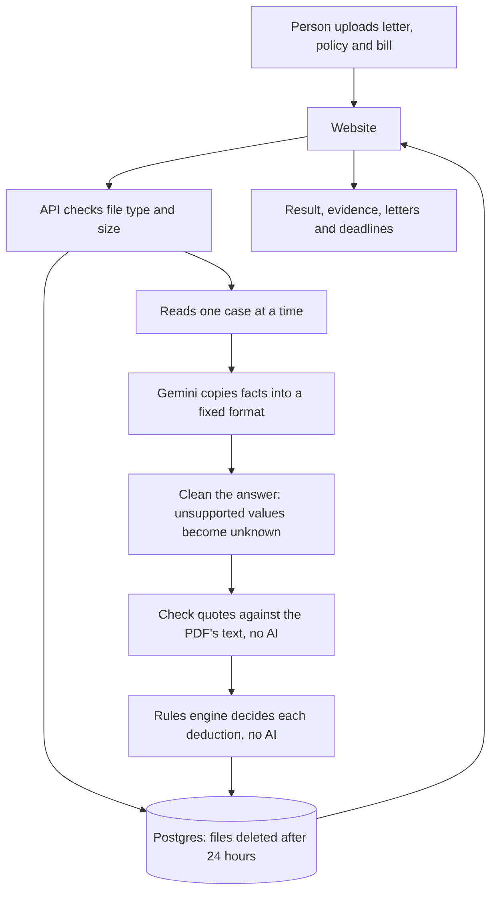
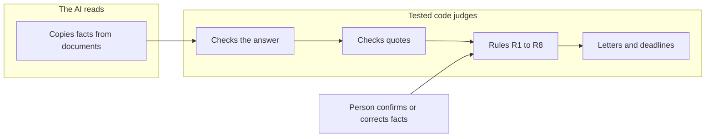
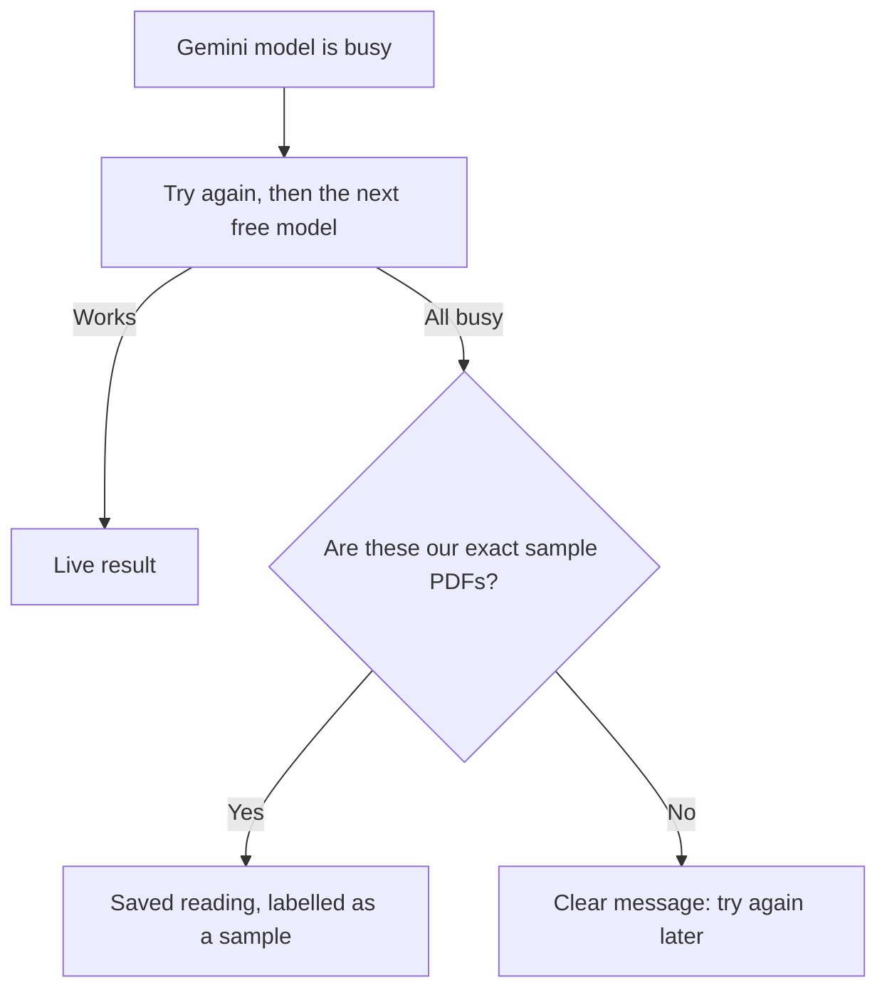

# How ClaimSathi works

## From upload to result

## What the AI can and can't do

Correcting a fact skips the AI completely, so the result changes instantly.

## When things go wrong

A saved reading can only match our own files, by their fingerprints, so a real document can never receive someone else's result.

## Hosting

| Part | Render service | Plan |
|---|---|---|
| Website | `claimsathi-web` | Free static site |
| API, including document reading | `claimsathi-api` | Free, sleeps when idle |
| Database | `claimsathi-db` | Free, expires after 30 days |
| Queue | `claimsathi-queue` | Free, set up but not used yet |

The free plan has no background worker, so the API reads documents itself. With paid hosting, that step could move to a separate worker.
